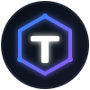

<div align="center">
  
</div>

<h1 align="center">Al-Tarek Attallah | Full Stack Software Engineer Portfolio</h1>

<p align="center">
  <strong>A modern, high-performance portfolio showcasing enterprise-grade engineering projects, real-world case studies, and technical writing.</strong>
</p>

<p align="center">
  <a href="#features">Features</a> •
  <a href="#tech-stack">Tech Stack</a> •
  <a href="#architecture">Architecture</a> •
  <a href="#local-development">Local Development</a>
</p>

---

## 🚀 Overview

This repository contains the source code for my personal portfolio website. It is designed to act not just as a resume, but as a demonstration of clean code, modular architecture, and modern UI/UX principles.

The portfolio heavily emphasizes **Backend & Enterprise Engineering** while maintaining a sleek, fully responsive, and animated frontend interface.

## ✨ Features

- **Dynamic Project Showcase:** A scalable, data-driven projects hub (`/projects/`) rendering project cards dynamically.
- **In-Depth Case Studies:** Dedicated technical breakdowns for complex systems like **MADMS** and the **Military Mess System**, detailing the architecture, database design, and business logic.
- **Technical Blog:** A custom-built blog section featuring deep dives into AI-assisted development, cloud architecture, and RESTful API design.
- **Interactive UI:** Smooth reveal animations, custom modal windows, responsive grid layouts, and interactive particles.
- **Modular Data Structure:** Project data and routing logic is abstracted into external JS modules (`src/data/projects.js`), keeping the HTML clean and maintainable.
- **Dark/Cyberpunk Aesthetic:** Built with a highly polished, developer-focused dark theme using modern CSS utilities.

## 🛠️ Tech Stack

- **Core:** HTML5, CSS3, Vanilla JavaScript (ES6 Modules)
- **Styling:** Custom CSS, Tailwind CSS Utility Classes, Flexbox & CSS Grid
- **Libraries & Tools:** 
  - [Swiper.js](https://swiperjs.com/) for interactive sliders
  - [Prism.js](https://prismjs.com/) for syntax highlighting in blog posts
  - [FormSubmit](https://formsubmit.co/) for serverless contact form handling
- **Architecture:** Component-based file structure (Features, Shared UI, Data layers)

## 📂 Project Structure

```text
├── index.html                   # Main homepage
├── projects/                    # Projects Hub & Case Studies
│   ├── index.html               # All projects grid
│   ├── madms/                   # Enterprise System Case Study
│   ├── medibook/                # Healthcare App Case Study
│   └── military-mess/           # Logistics App Case Study
├── blog/                        # Technical Articles
│   └── index.html               # Blog listing page
└── src/
    ├── assets/                  # CSS, Images, and Global Styles
    ├── data/                    # JSON/JS data models (projects.js)
    ├── features/                # Feature-specific logic (Hero, Work, Experience, Blog)
    └── shared/                  # Shared UI components (Modals, Preloader, Nav)
```

## 💻 Local Development

To run this project locally, you need a local web server (to avoid CORS issues with ES6 modules).

1. **Clone the repository**
   ```bash
   git clone https://github.com/modola0100/-Portfolio.git
   cd -Portfolio
   ```

2. **Serve the project**
   You can use any local server, such as `serve`, `http-server`, or the VS Code Live Server extension.
   ```bash
   npx serve .
   ```

3. **View in browser**
   Open `https://altarek-portfolio.vercel.app`

---
<div align="center">
  <p>Designed and Built by <b>Al-Tarek Attallah</b></p>
</div>
